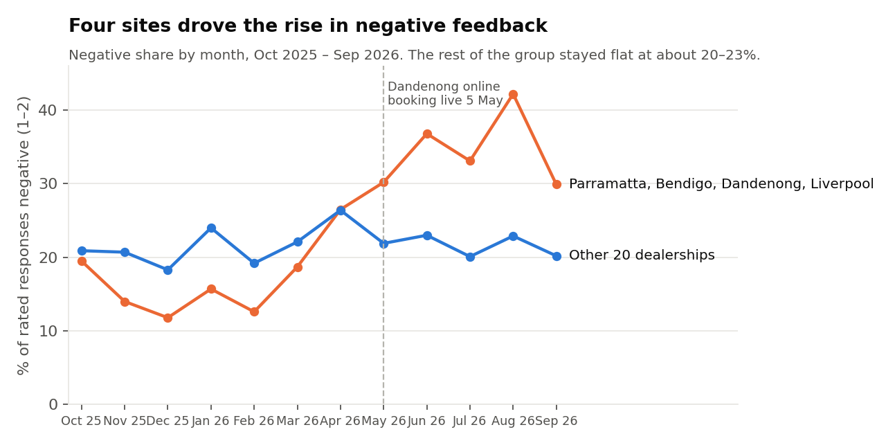
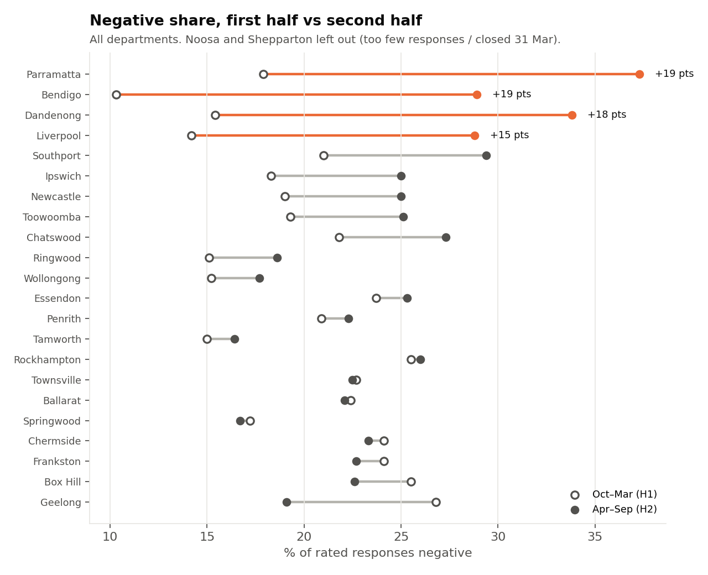
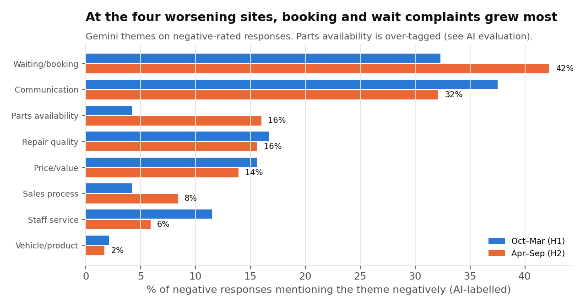
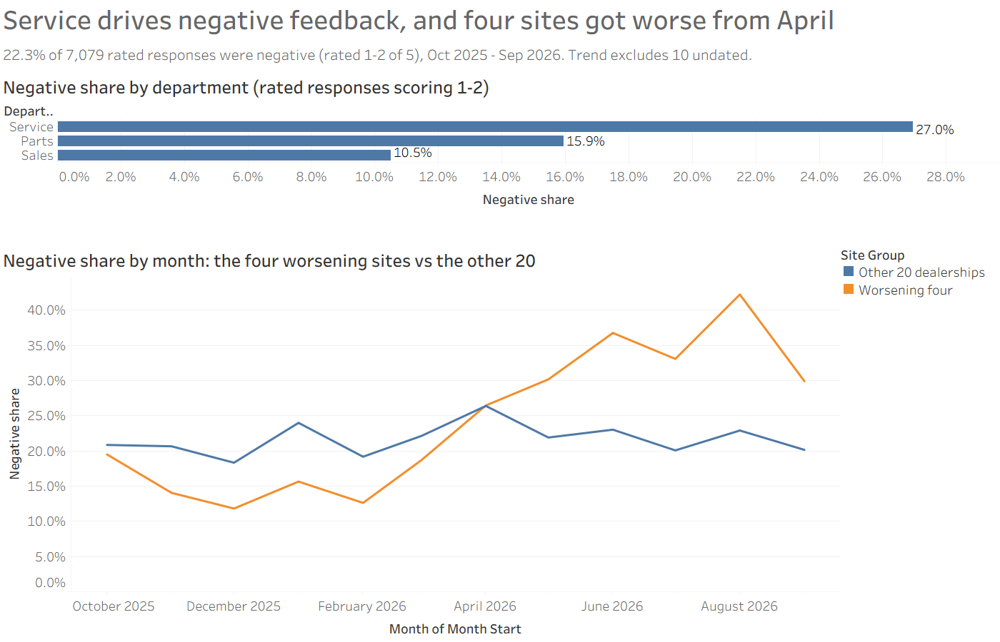
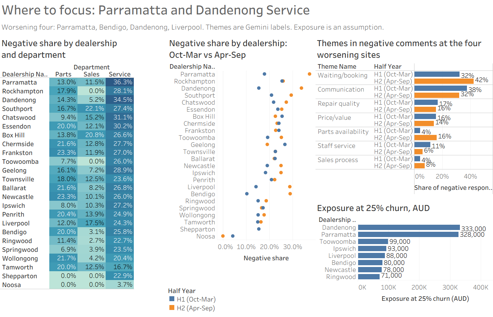
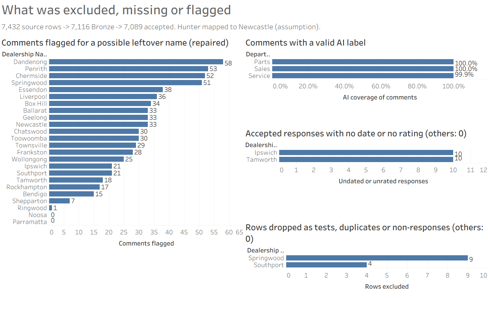

# Kestrel Motor Group: what's driving negative customer feedback

## The answer

- **Service is the problem.** Service accounts for 1,306 of the 1,579 negative responses (83%) and is negative 27% of the time. Parts is at 16% and Sales at 11%.
- **Across Service, the drivers are poor communication and waiting.** Among AI-labelled negative Service comments, 38% complain about updates and follow-up, and 35% about waiting, booking or scheduling. Repair quality (18%) and price (17%) come well behind.
- **Four sites got much worse in the second half of the year, while the rest stayed flat.** Parramatta (18% → 37% negative), Dandenong (15% → 34%), Bendigo (10% → 29%) and Liverpool (14% → 29%). Together they went from 13% in Feb to 42% in Aug, while the other 20 dealerships stayed at 20–23%.
- **At those four sites, booking and wait complaints grew most.** They rose from 32% to 42% of negative comments. This lines up with Dandenong's online booking going live on 5 May and with Bendigo absorbing Shepparton's customers after it closed on 31 Mar.
- **Focus on Dandenong and Parramatta Service first.** They hold more than half of the estimated revenue exposure: about **$660k of $1.17M** across the top 8 sites (range $0.47M–$1.87M depending on churn).



**Interactive Tableau dashboard:** [Kestrel Motor Group - Customer Feedback on Tableau Public](https://public.tableau.com/app/profile/abdul.basith.mohammed7821/viz/KestrelMotorGroup-CustomerFeedback/KestrelMotorGroupwhatsdrivingnegativefeedback). The packaged workbook is [`tableau/kestrel_cx.twbx`](tableau/kestrel_cx.twbx), and screenshots are in the [Dashboard](#dashboard) section.

## Approach

```
52 dealer files ──> Bronze ──────────────> Silver ──────────────────────> Gold (dbt) ──> CSV export ──> Tableau
 (CSV / Excel,       mapped text + lineage,    one row per response,          facts, theme bridge,
  every sheet)       names/contacts masked  1–5 rating, flags, DQ rules    monthly revenue, tests
                     before storage              │
                                                 └─> Gemini: sentiment + themes on masked comments
                                                     (cached, versioned, checked against my labels)
```

- **DuckDB** gives me one local file with SQL and no server for an assessor to set up.
- **YAML source config** (`config/sources.yml`) holds every per-dealer rule in one readable place: sheets, header rows, date formats, rating scales and aliases.
- **dbt** builds Gold with tests (49 passing, including dealer-history checks), and publishes only if they pass. Revenue joins at its own monthly grain, never through the multi-theme bridge.
- **Prefect** runs the existing CLI steps in order with local run history and logging: `python flows/pipeline.py`. Only the opt-in Gemini step retries; other failures stop the flow.
- **Gemini** handled sentiment and themes. I tried a local Ollama model first, but the pilot was too slow for the full run. Comments were preprocessed before transmission, but some residual names reached Gemini. Accounted API cost was approximately US$1.94.

## Data quality: what I found and what I did

All 7,432 physical rows across the files reconcile: **7,116 land in Bronze and 7,089 responses go into the analysis**, after removing headers, summary and total rows, non-responses, test entries and probable duplicates. Of those, 7,079 have a valid rating. This matches my first pandas baseline row for row. Every rule's pass/fail counts are in [`outputs/dq_results.csv`](outputs/dq_results.csv).

| Source | Problem | What I did |
|---|---|---|
| Geelong | Rating scale direction reverses between 2025 and 2026 | Reversed 2025 so 5 = best everywhere |
| Ringwood | Template and 10-point scale change mid-sheet | Rescaled linearly to 1–5, kept the raw score |
| Bendigo / Tamworth / Ballarat | Stars, Bad/OK/Good, text labels | Explicit mappings to 1–5 |
| Penrith | June tab is a copy of July | Counted once as July; June treated as missing |
| Chermside | Two "FINAL" Q1 files, v2 has 6 extra rows | Used v2 only |
| Toowoomba | Q4 summary counts, not responses | Excluded from response-level analysis |
| Southport | Google reviews with relative dates ("3 months ago") | Kept in totals, excluded from trends |
| Hunter Motors | Not in the dealer list | Mapped to Newcastle (NSW05) and **flagged as an assumption** |
| Shepparton | Closed 31 Mar 2026; 6 rows misdated to 2026 | Kept up to closure, corrected and flagged the dates, left out of "where to focus" |
| Liverpool / North QLD / Wollongong | US month-first dates, Excel serials, `dd-Mon-yy` | Per-source date formats |
| Chatswood / Wollongong | Semicolon delimiter, cp1252 encoding | Per-source read settings |
| Frankston | Repeated header blocks and "Total" rows | Header detection plus a total-row rule |

Other rules:
- **Negative** means a normalised rating of 2 or below.
- **Missing ratings stay null.** I never imputed them from comment text, and AI sentiment is a separate field.
- **Duplicates** are a heuristic, because there's no natural key. They're defined as same dealer, date, department, rating and comment. This can exclude genuinely separate identical responses, so duplicate decisions retain lineage for review.

**Privacy:** I treated all personal data as real. Source-known customer and staff names are masked as [CUSTOMER] and [STAFF] before database storage. Identifier columns are read in memory for masking and omitted from persisted records. Masking counts: 190 staff names, 58 emails, 156 phones and 486 regos. Raw data, the database and labels stay out of Git. Gemini later flagged 663 comments with possible leftover names, so the masking isn't perfect. I replaced the faulty offset-based proposals with exact-string proposals; wider human review is still pending. I record the limitation in the [AI log](AI_USAGE_LOG.md).

## Business answers

**1. Drivers by dealership and department.** Service negative share is highest at Parramatta (36%), Dandenong (35%), Chatswood (31%) and Essendon (30%). Sales and Parts are low almost everywhere. The main theme in each department:

| Department | Negative | Top negative themes (share of AI-labelled negative responses) |
|---|---|---|
| Service | 27% | Communication/follow-up 38%, waiting/scheduling 35%, repair quality 18%, price 17% |
| Parts | 16% | Parts availability 55%, communication 39%, waiting 32% |
| Sales | 11% | Sales process 57%, communication 30%, staff 20% |

**2. Change over the year.**





Four sites stand out, and Geelong improved (27% → 19%). At the four worsening sites, waiting and booking complaints grew from 32% to 42% of negatives. Parts availability also grew (4% → 16%), but Gemini over-tags this theme, so I treat it as a lead to check rather than a finding.

**3. What it's worth.** I estimate the revenue exposure from the extra negative Service experiences in Apr–Sep, above each site's own Oct–Mar rate. It's priced at 12 months of that customer's service revenue, using `monthly_revenue.csv`.

| Site | Service negative H1 → H2 | Exposure at 10% / 25% / 40% churn |
|---|---|---|
| Dandenong | 20% → 47% | $133k / **$333k** / $533k |
| Parramatta | 23% → 49% | $131k / **$328k** / $526k |
| Toowoomba | 21% → 29% | $40k / $99k / $158k |
| Ipswich | 22% → 33% | $37k / $93k / $149k |
| Liverpool | 19% → 30% | $35k / $88k / $141k |
| Bendigo | 15% → 33% | $32k / $80k / $129k |
| Newcastle | 21% → 31% | $31k / $78k / $124k |
| Ringwood | 20% → 25% | $28k / $71k / $114k |
| **Top 8 total** | | **$0.47M / $1.17M / $1.87M** |

This is potential exposure, not proven loss. It assumes the feedback sample is representative of all service jobs and that churn falls in the stated range. Full table: [`outputs/business_answers/q3_value_at_risk.csv`](outputs/business_answers/q3_value_at_risk.csv).

## Dashboard

[Open the published Tableau story](https://public.tableau.com/app/profile/abdul.basith.mohammed7821/viz/KestrelMotorGroup-CustomerFeedback/KestrelMotorGroupwhatsdrivingnegativefeedback). The overview and priority pages were opened successfully in browser review; the third page and all interactive marks have not yet been independently checked.

The published Tableau story has three sections: **What's driving it**, **Where to focus** and **Can we trust it**, built on the **Gold reporting export**, which holds reporting fields only, with no names and no comment text. `scripts/prepare_tableau.py` turns the export into four small CSVs in `tableau/extracts/`, and the workbook is [`tableau/kestrel_cx.twbx`](tableau/kestrel_cx.twbx).

| View | What it shows | Gold source |
|---|---|---|
| **CX overview** | Negative share by department, monthly trend (worsening four vs the rest), rating coverage | fct_feedback, monthly summary |
| **Dealer investigation** | Dealer × department heatmap, H1 vs H2 change, Service themes at the four worsening sites, $ exposure scenarios (labelled as assumptions) | dealer/department summary, theme bridge, financial sensitivity |
| **Data quality** | Missing ratings and dates, provisional mappings (Hunter → Newcastle), AI enrichment coverage and errors, DQ rule results | quality mart, dq_results |

- **Reconciliation:** the published headline shows the full Gold baseline: 1,579 negative out of 7,079 rated responses (22.3%). The monthly extract excludes 10 undated responses and therefore contains 7,079 responses, 7,069 valid ratings and 1,576 negative ratings; its percentages use those dated counts. The preparation script checks response-count reconciliation. Full per-view published-value reconciliation is still a review step.
- **Refresh:** rebuild Gold, rerun `python scripts/run_business_answers.py`, copy the refreshed Q3 result to `outputs/business_answers/q3_value_at_risk.csv`, then run `python scripts/prepare_tableau.py`. Refresh/reconnect the workbook data sources in Tableau and republish. A packaged workbook carries its own copy of the data: regenerating local CSVs or running Prefect does not update the public story automatically.








## Recommendations

1. **Fix booking at Dandenong and Parramatta now.** Review the online booking flow and the May booking-reference change, and look at confirmations, double-bookings and lead times. These two sites hold more than half the exposure.
2. **Proactive service updates group-wide.** Communication is the top Service complaint at every site. An SMS at drop-off, a mid-job update and a callback rule when a job runs late are cheap to try.
3. **Check Bendigo capacity.** Its rise starts when Shepparton's customers were redirected there. Compare booking lead times and staffing against volume.
4. **Track it monthly.** Alert when a site's Service negative share runs 10 pts above the group for two months running. On the monthly trend, the four sites together crossed that line in June (37% vs 23%).
5. **Standardise the feedback template.** One sheet layout, a 1–5 scale, ISO dates and the dealer code would remove most of the cleaning effort shown above.

## Can the AI be trusted?

- **Human check.** I labelled 49 of a 50-comment sample (all dealerships, departments and rating bands) before seeing any predictions.
  - Sentiment: 46/49 agree (94%).
  - Leftover names: 48/49 agree.
  - Themes: at least one theme matches on 42/46 (91%).
- **Rating alignment (not independent accuracy).** Gemini sentiment broadly aligns with customer scores. 91% of 1–2 ratings come back negative and 92% of 4–5 ratings come back positive, and only 10 of 3,145 high ratings were called negative.
- **Known weaknesses.**
  - Gemini sometimes tags `parts_availability` when only the parts team is mentioned.
  - It struggles with very short comments.
  - It once misread "slow and clear" (a positive explanation) as mixed.
  - The sample is deliberately mixed, so these are diagnostic numbers, not population accuracy.

Details: [`outputs/gemini_evaluation.json`](outputs/gemini_evaluation.json) and [AI usage log](AI_USAGE_LOG.md).

## Production next steps

I built this as a batch run on a laptop. To run it in production I would add:

- **File arrival:** a landing-folder watcher with file hashing, skip-if-loaded, and archive/quarantine with a reason.
- **Run control:** a run registry with states, retries and a run_id on every row, so loads are incremental instead of full rebuilds.
- **Orchestration:** the local Prefect batch flow is implemented; production scheduling and failure alerts remain to add. Only the AI step retries.
- **History:** dealer-reference SCD2 snapshots are implemented; stable edit identity for running feedback workbooks remains to add.
- **Privacy:** named-entity detection on top of the current masking, and a keyed HMAC customer key if repeat-customer analysis is needed. Secrets go in a vault.
- **AI operations:** pinned model and prompt versions, a fresh labelled sample each quarter, and a drift check on sentiment-vs-rating agreement.
- **Reporting:** a live Tableau connection, or a scheduled Hyper extract refresh, instead of manual CSV exports.

## How to run

Tested with Python 3.14 on Windows. Obtain the assignment source data separately. Rebuilding Bronze/Silver replaces their tables; use a new database for an independent reproduction. AI labels require the optional provider run; without them, Gold still builds rating/revenue reports with zero AI coverage.

```bash
pip install -r requirements.txt
# put the supplied feedback/ and reference/ folders in the project root (gitignored)
# One-command batch run (Gemini off):
python flows/pipeline.py
# Paid enrichment opt-in: python flows/pipeline.py --enrich --budget-usd 5
# Or run individual steps:
python src/bronze.py --database data/bronze_review.duckdb
python src/silver.py --database data/bronze_review.duckdb
# Optional cloud inference: needs GEMINI_API_KEY in local .env and incurs API costs.
# python src/gemini_enrichment.py --all --budget-usd 5
python src/gold.py                # builds/tests/publishes Gold and exports reporting CSVs
python scripts/run_business_answers.py  # writes data/business_answers/Q*.csv
# Optional: install matplotlib to regenerate the already-included charts
# python -m pip install matplotlib
python analysis/make_charts.py          # README charts from outputs/business_answers/
python scripts/prepare_tableau.py       # Tableau CSVs in tableau/extracts/
python -m unittest discover -s tests -p test_gold_publication.py
# Open scripts/investigation.ipynb with Jupyter for the source investigation.
```

Assumptions and their impact: [ASSUMPTIONS.md](ASSUMPTIONS.md). How I used AI: [AI_USAGE_LOG.md](AI_USAGE_LOG.md). Source investigation: [`scripts/investigation.ipynb`](scripts/investigation.ipynb).

### Local orchestration limits

Run history is kept locally under ignored `data/prefect/` unless an existing Prefect server configuration overrides it. No cloud setup is required. Each step invokes the same CLI listed above. The Gold CLI owns the dbt test/publication gate. A Silver failure prevents Gold and answers; an exhausted AI retry also stops publication. Gemini has at most three attempts and its dollar ceiling is **per attempt**, so a USD 5 setting can allow up to USD 15 across retries; cached successes are reused. The flow does not log comment text or subprocess output. This is batch orchestration, not the guide's incremental file watcher, hash-skip/archive lifecycle or row-level run registry.

To view local run history in the Prefect UI, start the server from the project root in one terminal:

```powershell
$env:PREFECT_HOME = Join-Path (Get-Location) 'data/prefect'
prefect server start --host 127.0.0.1
```

Open `http://127.0.0.1:4200`. In a second terminal using the same Python environment, run:

```powershell
$env:PREFECT_API_URL = 'http://127.0.0.1:4200/api'
python flows/pipeline.py
```

The temporary server used by a plain CLI run stops when that process exits; the local history remains. Do not launch concurrent flows against the same DuckDB files. Tests: `python -m unittest discover -s tests -p test_prefect_pipeline.py`.

### Dealer reference history (SCD2)

Each Gold build snapshots `reference/dealerships.csv` before building dependent models. Changes to dealership name, suburb, state, region, brands, status or closure date close the previous version and create a new version. Unchanged rows retain their version IDs. A removed dealer has its current version closed; reappearance creates a new version.

`gold.dim_dealer_history` exports the version ID, dealer attributes, `valid_from`, `valid_to` and `is_current`. Intervals are `[valid_from, valid_to)`; null `valid_to` means current. `gold.dim_dealer` stays one current row per dealer so existing report joins do not multiply feedback or revenue.

Dates record **when the pipeline observed a reference change**, not when it took effect in the business. The source has no attribute-change timestamp or earlier reference versions: the first run initialises history and does not reconstruct 2025/26 dealer attributes. Closure date remains a source attribute, distinct from snapshot validity. Historical feedback/revenue reports still use the current dealer view; an event-time SCD join would need trustworthy effective-dated reference history. Tests cover unchanged reloads, changes, deletions, reappearance, non-overlapping intervals and current/reference reconciliation. Run `python -m unittest discover -s tests -p test_dealer_history.py` for the isolated fixture test.
